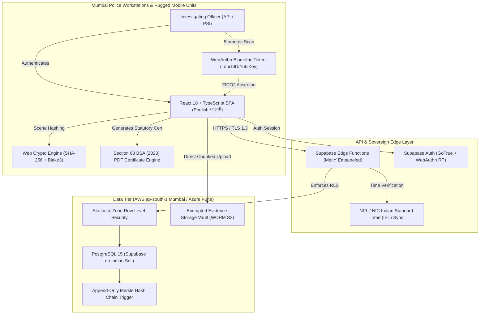
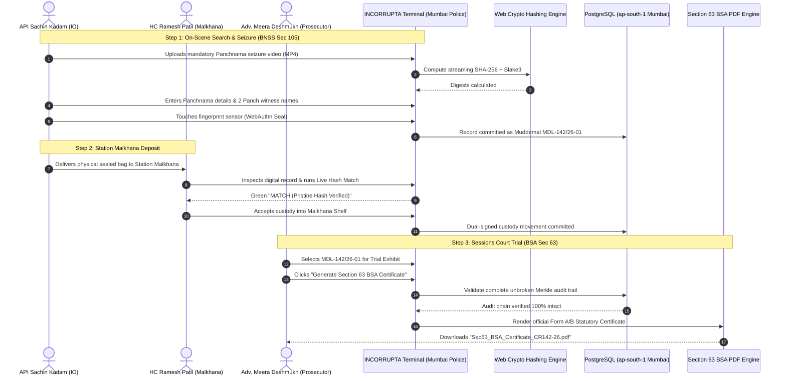

# 04_ARCHITECTURE.md — System Architecture & Backend Specification: INCORRUPTA (Mumbai Police Edition)

- **Purpose:** Define technical architecture, PostgreSQL schema DDL, API contracts, sequence diagrams, and data storage rules localized for the **Mumbai Police (मुंबई पोलीस)** and the **Bharatiya Sakshya Adhiniyam, 2023**.
- **Status:** Draft v1 (Mumbai Police Customization)
- **Last Updated:** 2026-09-25
- **Depends On:** `docs/01_PRD.md`, `docs/02_TRD.md`, `docs/03_UIUX.md`

---

## 1. High-Level Architecture Overview



---

## 2. Database Schema DDL (Mumbai Police & BSA 2023 Specialized)

```sql
-- 1. ROLES & RANKS
CREATE TYPE mumbai_police_rank AS ENUM (
    'COMMISSIONER_OF_POLICE', 'JOINT_CP', 'ADDITIONAL_CP', 'DEPUTY_CP',
    'ASSISTANT_CP', 'SENIOR_POLICE_INSPECTOR', 'POLICE_INSPECTOR',
    'ASSISTANT_POLICE_INSPECTOR', 'POLICE_SUB_INSPECTOR',
    'HEAD_CONSTABLE', 'POLICE_NAIK', 'POLICE_CONSTABLE', 'PUBLIC_PROSECUTOR'
);

CREATE TABLE public.roles (
    id UUID PRIMARY KEY DEFAULT gen_random_uuid(),
    role_name VARCHAR(50) UNIQUE NOT NULL, -- 'SUPER_ADMIN', 'MALKHANA_IN_CHARGE', 'INVESTIGATING_OFFICER', 'PROSECUTOR', 'AUDITOR'
    description TEXT,
    created_at TIMESTAMPTZ NOT NULL DEFAULT timezone('utc'::text, now())
);

-- 2. USERS (MUMBAI POLICE PERSONNEL)
CREATE TABLE public.users (
    id UUID PRIMARY KEY REFERENCES auth.users(id) ON DELETE CASCADE,
    sevarth_id VARCHAR(50) UNIQUE NOT NULL, -- Maharashtra Gov Sevarth Employee ID (e.g., 'MH-POL-40211')
    badge_number VARCHAR(50) UNIQUE NOT NULL,
    full_name VARCHAR(150) NOT NULL,
    full_name_marathi VARCHAR(150), -- Marathi script name for court certificates
    police_rank mumbai_police_rank NOT NULL,
    posted_police_station VARCHAR(150) NOT NULL, -- e.g. 'BKC Cyber Police Station', 'Azad Maidan PS'
    police_zone VARCHAR(50) NOT NULL, -- e.g. 'Zone I', 'Zone VIII', 'Crime Branch CID'
    clearance_level INT NOT NULL DEFAULT 1 CHECK (clearance_level BETWEEN 1 AND 5),
    role_id UUID NOT NULL REFERENCES public.roles(id),
    is_active BOOLEAN NOT NULL DEFAULT true,
    webauthn_credential_id TEXT,
    webauthn_public_key TEXT,
    webauthn_sign_counter BIGINT DEFAULT 0,
    created_at TIMESTAMPTZ NOT NULL DEFAULT timezone('utc'::text, now()),
    updated_at TIMESTAMPTZ NOT NULL DEFAULT timezone('utc'::text, now())
);
CREATE INDEX idx_users_sevarth ON public.users(sevarth_id);
CREATE INDEX idx_users_station ON public.users(posted_police_station);

-- 3. CASES (POLICE STATION FIRST INFORMATION REPORTS - FIR / CR)
CREATE TYPE case_status AS ENUM (
    'UNDER_INVESTIGATION', 'CHARGESHEET_FILED', 'PENDING_TRIAL', 'ADJUDICATED', 'COLD_CASE', 'EXPUNGED'
);

CREATE TABLE public.cases (
    id UUID PRIMARY KEY DEFAULT gen_random_uuid(),
    cr_number VARCHAR(100) UNIQUE NOT NULL, -- Crime Register Number e.g. 'CR No. 142/2026'
    police_station VARCHAR(150) NOT NULL, -- e.g. 'BKC Cyber Crime Police Station'
    fir_date TIMESTAMPTZ NOT NULL,
    title VARCHAR(255) NOT NULL,
    penal_sections TEXT[] NOT NULL, -- e.g. ['BNS 316(2)', 'BNS 318(4)', 'IT Act 66D']
    status case_status NOT NULL DEFAULT 'UNDER_INVESTIGATION',
    investigating_officer_id UUID NOT NULL REFERENCES public.users(id),
    supervising_acp_id UUID REFERENCES public.users(id),
    designated_court VARCHAR(200) NOT NULL, -- e.g. 'City Civil & Sessions Court, Fort, Mumbai' or 'Esplanade Court (Killa Court)'
    description TEXT,
    created_at TIMESTAMPTZ NOT NULL DEFAULT timezone('utc'::text, now()),
    updated_at TIMESTAMPTZ NOT NULL DEFAULT timezone('utc'::text, now())
);
CREATE INDEX idx_cases_cr_number ON public.cases(cr_number);
CREATE INDEX idx_cases_station ON public.cases(police_station);
CREATE INDEX idx_cases_io ON public.cases(investigating_officer_id);

-- 4. CASE ASSIGNMENTS
CREATE TABLE public.case_assignments (
    id UUID PRIMARY KEY DEFAULT gen_random_uuid(),
    case_id UUID NOT NULL REFERENCES public.cases(id) ON DELETE CASCADE,
    officer_id UUID NOT NULL REFERENCES public.users(id) ON DELETE CASCADE,
    assigned_by UUID NOT NULL REFERENCES public.users(id),
    can_modify BOOLEAN NOT NULL DEFAULT false,
    assigned_at TIMESTAMPTZ NOT NULL DEFAULT timezone('utc'::text, now()),
    UNIQUE(case_id, officer_id)
);

-- 5. EVIDENCE (MUDDEMAL PROPERTY REGISTER - मुद्देमाल रजिस्टर)
CREATE TYPE evidence_category AS ENUM (
    'SEARCH_SEIZURE_VIDEOGRAPHY_BNSS105', 'MOBILE_PHONE_EXTRACTION', 'CCTV_DVR_RECORDING',
    'HARD_DISK_FORENSIC_IMAGE', 'CALL_DETAIL_RECORD_CDR', 'WHATSAPP_FORENSIC_EXPORT',
    'FINANCIAL_LEDGER_PDF', 'NETWORK_PCAP_PACKET', 'OTHER'
);

CREATE TYPE muddemal_status AS ENUM (
    'INGESTED_PRISTINE', 'IN_POLICE_MALKHANA', 'DISPATCHED_TO_KALINA_FSL',
    'RETURNED_FROM_FSL', 'PRODUCED_IN_COURT', 'RETURNED_TO_OWNER', 'SEALED_CONFIDENTIAL'
);

CREATE TABLE public.evidence (
    id UUID PRIMARY KEY DEFAULT gen_random_uuid(),
    case_id UUID NOT NULL REFERENCES public.cases(id) ON DELETE CASCADE,
    muddemal_number VARCHAR(100) UNIQUE NOT NULL, -- Unique Property Item Number e.g. 'MDL-142/26-01'
    title VARCHAR(255) NOT NULL,
    category evidence_category NOT NULL,
    status muddemal_status NOT NULL DEFAULT 'INGESTED_PRISTINE',
    panchnama_reference VARCHAR(100) NOT NULL, -- e.g. 'PAN-BKC-2026-089'
    panch_witnesses JSONB NOT NULL DEFAULT '[]'::jsonb, -- [{name, address, phone}]
    seizure_location JSONB NOT NULL DEFAULT '{}'::jsonb, -- {address, latitude, longitude}
    seizure_timestamp TIMESTAMPTZ NOT NULL,
    source_device_info JSONB NOT NULL DEFAULT '{}'::jsonb, -- {make, model, imei, serial_no, os}
    seizing_io_id UUID NOT NULL REFERENCES public.users(id),
    current_custodian_id UUID NOT NULL REFERENCES public.users(id),
    malkhana_shelf_location VARCHAR(100), -- Physical locker inside Police Station Malkhana
    dfsl_kalina_acknowledgement_no VARCHAR(100), -- State FSL Kalina case token
    storage_bucket VARCHAR(100) NOT NULL,
    storage_path TEXT NOT NULL,
    file_size_bytes BIGINT NOT NULL,
    mime_type VARCHAR(100) NOT NULL,
    is_sealed BOOLEAN NOT NULL DEFAULT false,
    created_at TIMESTAMPTZ NOT NULL DEFAULT timezone('utc'::text, now()),
    updated_at TIMESTAMPTZ NOT NULL DEFAULT timezone('utc'::text, now())
);
CREATE INDEX idx_evidence_muddemal ON public.evidence(muddemal_number);
CREATE INDEX idx_evidence_case ON public.evidence(case_id);
CREATE INDEX idx_evidence_status ON public.evidence(status);

-- 6. EVIDENCE HASHES (SECTION 63 BSA BASELINE)
CREATE TABLE public.evidence_hashes (
    id UUID PRIMARY KEY DEFAULT gen_random_uuid(),
    evidence_id UUID NOT NULL REFERENCES public.evidence(id) ON DELETE CASCADE,
    sha256_hash CHAR(64) NOT NULL,
    blake3_hash VARCHAR(128) NOT NULL,
    calculated_at TIMESTAMPTZ NOT NULL DEFAULT timezone('utc'::text, now()),
    calculated_by UUID NOT NULL REFERENCES public.users(id),
    verification_passed BOOLEAN NOT NULL DEFAULT true,
    hashing_event_stage VARCHAR(50) NOT NULL -- 'SCENE_SEIZURE_PANCHNAMA', 'MALKHANA_INTAKE', 'KALINA_FSL_RECEIPT', 'COURT_PRODUCTION'
);
CREATE INDEX idx_hashes_evidence ON public.evidence_hashes(evidence_id);
CREATE INDEX idx_hashes_sha256 ON public.evidence_hashes(sha256_hash);

-- 7. CHAIN OF CUSTODY (MUDDEMAL MOVEMENT LEDGER)
CREATE TYPE custody_movement_type AS ENUM (
    'SCENE_SEIZURE_TO_MALKHANA', 'MALKHANA_TO_KALINA_FSL', 'KALINA_FSL_TO_MALKHANA',
    'MALKHANA_TO_COURT_EXHIBIT', 'INTERNAL_IO_INVESTIGATION', 'RETURN_TO_COMPLAINANT'
);

CREATE TABLE public.chain_of_custody (
    id UUID PRIMARY KEY DEFAULT gen_random_uuid(),
    evidence_id UUID NOT NULL REFERENCES public.evidence(id) ON DELETE CASCADE,
    transferor_id UUID NOT NULL REFERENCES public.users(id),
    transferee_id UUID NOT NULL REFERENCES public.users(id),
    movement_type custody_movement_type NOT NULL,
    purpose_memo TEXT NOT NULL,
    verification_hash CHAR(64) NOT NULL,
    transferor_signature TEXT NOT NULL, -- WebAuthn signature
    transferee_signature TEXT NOT NULL, -- WebAuthn signature
    custody_sequence_number BIGINT NOT NULL,
    previous_event_hash CHAR(64) NOT NULL,
    current_event_hash CHAR(64) NOT NULL,
    recorded_at TIMESTAMPTZ NOT NULL DEFAULT timezone('utc'::text, now())
);
CREATE INDEX idx_coc_evidence ON public.chain_of_custody(evidence_id);

-- 8. AUDIT LOGS (APPEND-ONLY CRYPTOGRAPHIC HASH CHAIN)
CREATE TABLE public.audit_logs (
    id UUID PRIMARY KEY DEFAULT gen_random_uuid(),
    actor_id UUID REFERENCES public.users(id),
    action_verb VARCHAR(50) NOT NULL, -- 'VIEW', 'PLAY_MEDIA', 'EXPORT_SEC63_CERT', 'TRANSFER_MUDDEMAL'
    target_entity VARCHAR(50) NOT NULL,
    target_id UUID NOT NULL,
    payload_snapshot JSONB NOT NULL DEFAULT '{}'::jsonb,
    ip_address INET,
    user_agent TEXT,
    previous_log_hash CHAR(64) NOT NULL,
    current_log_hash CHAR(64) NOT NULL,
    timestamp TIMESTAMPTZ NOT NULL DEFAULT timezone('utc'::text, now())
);
CREATE INDEX idx_audit_timestamp ON public.audit_logs(timestamp);

-- 9. AUTHENTICATION EVENTS
CREATE TABLE public.authentication_events (
    id UUID PRIMARY KEY DEFAULT gen_random_uuid(),
    user_id UUID REFERENCES public.users(id),
    event_type VARCHAR(50) NOT NULL,
    sign_counter_value BIGINT,
    ip_address INET,
    user_agent TEXT,
    client_error TEXT,
    created_at TIMESTAMPTZ NOT NULL DEFAULT timezone('utc'::text, now())
);
```

---

## 3. Sequence Diagram: Seizure under BNSS 105 to Section 63 BSA Export


