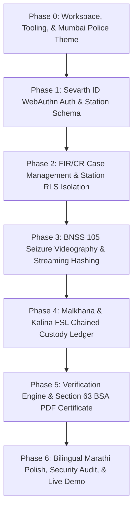

# 08_PHASES.md — Development Phases & Execution Roadmap: INCORRUPTA (Mumbai Police Edition)

- **Purpose:** Structure sequential development phases, milestones, testable exit gates, and demo scripts localized for the **Mumbai Police**.
- **Status:** Draft v1 (Mumbai Police Customization)
- **Last Updated:** 2026-09-25
- **Depends On:** `docs/06_TICKETS.md`, `docs/07_RULES.md`

---

## 1. Phase Dependency Diagram

---

## 2. Phase Specifications (Mumbai Police Adaptations)

### Phase 0: Workspace Setup, Tooling, CI, & Mumbai Police Theme
- **Included Tickets:** `T-001`, `T-002`, `T-003`.
- **Deliverables:** Working React 18 + Vite 5 workspace; TailwindCSS theme with Mumbai Police navy (`#070D1E`), police slate (`#0E172E`), gold insignia (`#D4AF37`), and cyan (`#00B4D8`); GitHub Actions CI pipeline.
- **Demo Script:** Run `npm run dev`, open `localhost:5173`, observe Mumbai Police crest with State Motto (*सद्रक्षणाय खलनिग्रहणाय*).

### Phase 1: Sevarth ID WebAuthn Auth & Database Schema
- **Included Tickets:** `T-004`, `T-005`, `T-006`.
- **Deliverables:** Mumbai Police PostgreSQL schema DDL (with `sevarth_id`, `police_rank`, `cr_number`, `muddemal_number`); WebAuthn relying party; `/login` page supporting Sevarth ID and biometric TouchID/YubiKey.
- **Demo Script:** Enter Sevarth ID `MH-POL-40211`, touch biometric sensor, observe instant redirect to the BKC Cyber Police Station portal.

### Phase 2: FIR / CR Case Management & Station RLS Isolation
- **Included Tickets:** `T-007`, `T-008`.
- **Deliverables:** Crime Register (CR) dashboard; FIR creation modal with BNS 2023 penal sections; PostgreSQL Row Level Security enforcing police station and zone clearance.
- **Demo Script:** Create `CR No. 142/2026, BKC Cyber Police Station`, assign API Sachin Kadam, verify Azad Maidan PS officers cannot access the record.

### Phase 3: BNSS 105 Seizure Videography & Streaming Hashing
- **Included Tickets:** `T-009`, `T-010`, `T-011`.
- **Deliverables:** Streaming Web Crypto hasher (`streamHasher.ts`); S3 upload handler; `IngestionPage.tsx` with Panchnama reference, 2 Panch witness records, and IO biometric sealing button.
- **Demo Script:** Drag search & seizure video into dropzone, watch live hashing meter stream to 100%, enter Panch witness details, touch fingerprint sensor to sign, receive unique Muddemal ID `MDL-142/26-01`.

### Phase 4: Malkhana & Kalina FSL Chained Custody Ledger
- **Included Tickets:** `T-012`, `T-013`, `T-014`.
- **Deliverables:** Append-only PostgreSQL hash chain trigger; `<CustodyTimeline />` displaying station Malkhana deposit and Kalina FSL transit; dual WebAuthn step-up signing.
- **Demo Script:** Transfer `MDL-142/26-01` from API Kadam to Malkhana Mohrir HC Ramesh Patil, execute dual biometric verification, inspect unbroken Merkle timeline.

### Phase 5: Verification Engine & Section 63 BSA (2023) Certificate
- **Included Tickets:** `T-015`, `T-016`.
- **Deliverables:** Live cryptographic integrity comparator; client-side vector PDF generator producing official statutory **Section 63(4) Bharatiya Sakshya Adhiniyam, 2023** certificates with embedded QR codes.
- **Demo Script:** Click "Run Integrity Check" to observe green "MATCH" badge; click "Generate Section 63 BSA Certificate", download and inspect signed court-admissible PDF exhibit.

### Phase 6: Bilingual Marathi Polish, Security Audit, & Demo Packaging
- **Included Tickets:** `T-017`, `T-018`, `T-019`.
- **Deliverables:** Dual English / मराठी language support across all screens; automated RLS and station security regression suite; rich Mumbai Police demo seed data.
- **Demo Script:** Switch language to मराठी, walk through complete lifecycle from search seizure to court export in under 3 minutes.
